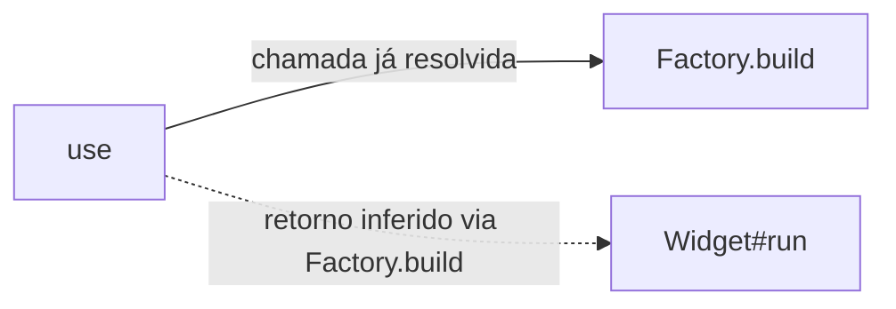

# A7, primeira etapa — candidatos de retorno de fábricas simples

Entrega posterior a `f832e2b1b`. Acrescenta uma inferência estática limitada para
expressões construtoras diretas. Não é inferência global de tipos Ruby e não
atribui garantias de runtime às novas relações.

## Exemplo e resultado

```ruby
class Widget
  def run
    :ok
  end
end

class Factory
  def self.build
    Widget.new
  end
end

def use
  Factory.build.run
end
```

O grafo já encontrava a chamada `use -> Factory.build`. Agora pode acrescentar
`use -> Widget#run`, com evidência `return_type_inferred`, candidato de receiver
`Widget` e origem `via = ["Factory.build"]`.



A relação nova significa: segundo o padrão sintático e o modelo de lookup do
projeto, o receiver pode ser uma instância de `Widget` se a fábrica devolver
normalmente. Não prova que a chamada termina, é alcançada, passa na construção
ou executa sempre esse método. As arestas novas **não são supported** e ficam
fora de `MARTA_GRAPH_CONTEXT=supported_only`. O contexto do grafo identifica a
categoria e a fábrica que sustenta a hipótese.

## Padrões aceites e condições

O helper Prism existente extrai um facto quando o método tem uma única expressão
no corpo: `Widget.new(...)`, `return Widget.new(...)` ou a forma endless
`def self.build = Widget.new`. Não reabre/avalia o ficheiro-alvo nem lança outro
subprocesso. Os argumentos podem referir parâmetros, mas não podem conter
transferências de controlo reconhecidas ou blocos; a inspeção tem limites de
64 nós visitados e profundidade 12. Acima disso, abstém-se.

O índice de retornos exige ainda:

- uma única definição da fábrica fornecida;
- constante de classe do projeto, resolvida de forma única e exata;
- ausência de uma implementação própria de `.new` detetada no projeto para essa
  classe, superclasses conhecidas ou módulos que a estendem;
- política/estrutura de facto reconhecida.

A integração no grafo aceita uma única fábrica encontrada por lookup já
classificado `static_lookup`. Considera apenas um salto, com receiver de fábrica
constante, `self` ou implícito. A consulta do tipo de retorno é memorizada durante
a construção desse grafo; não faz propagação recursiva nem iteração até fixpoint.

O resultado é uma hipótese de instância, distinguida do método de classe:
`Factory.build` é chamado na classe, enquanto `Widget#run` é um método de
instância encontrado através do retorno. A chamada direta à fábrica conserva a
sua própria evidência, separada da hipótese sobre o resultado.

## Abstenções e fronteiras

Ficam desconhecidos nesta política: corpos com várias instruções, condições,
retornos múltiplos/nil, arrays, getters que devolvem ivars/cvars, recursão de
fábricas, variáveis locais atribuídas, anotações e tipos externos ao projeto.
Também não se tenta resolver wrappers como `(Widget.new)` ou reconstruir a
resolução lexical de uma constante curta. Safe navigation e blocos na cadeia
não ganham as novas arestas. Um método singleton `new` personalizado não é tratado como uma
fábrica normal nesta etapa.

O extrator reconhece caminhos constantes literais simples. Receivers dinâmicos
e definições com receiver explícito diferente de `self` não recebem factos
atribuídos ao dono lexical. Na leitura para `MethodInfo`, erros de parse removem
os factos de retorno e a metadata nova de receivers, conservando a política
anterior do parser para a restante informação recuperável.

Definições repetidas, classes ambíguas e constantes qualificadas ausentes não
escolhem um vencedor por ordem. O índice devolve candidatos vazios e um motivo
(por exemplo `ambiguous_definition`, `ambiguous_project_constant`,
`non_exact_constant_lookup` ou `custom_new`). Registos antigos sem metadata nova
continuam a significar desconhecido, não um tipo inferido automaticamente.

Ruby pode redefinir constantes, monkey-patch de `Class#new`, usar aliases,
metaprogramação, autoload externo ou comportamento não visível nos ficheiros
fornecidos. Esta etapa não resolve esses casos. Mesmo um padrão aceite mantém a
categoria inferida; não se transforma em contrato de retorno, tipo verificado
ou aresta garantida.

Para receivers de getter, uma hipótese positiva tem prioridade sobre o matching
por interface anterior e pode restringir esses candidatos. Quando não há hipótese
nova utilizável, mantém-se o fallback existente e a sua própria categoria duck
ou desconhecida. Isso não converte uma resolução duck numa certeza.

## Custo, cache e avaliação

Não há pedidos LLM, embeddings, instalações ou execução do alvo para inferir
tipos. Há pequenos factos no parse já existente e um índice em memória com custo
linear no número de definições; as consultas efetivamente usadas são memorizadas.
Os campos opcionais novos são omitidos do JSON quando não há informação, evitando
repetir proveniência vazia em todas as arestas/métodos.

Um grafo diferente pode mudar o conteúdo — e, em alguns casos, a aplicação/custo —
das fases posteriores de enriquecimento e propagação. Essa consequência deve ser
medida; não se afirma que a análise inteira passa a custar o mesmo nem que ficou
mais rápida. Os orçamentos de contexto e os caps de geração existentes continuam
a governar os pedidos. A precisão/alcance das novas hipóteses também exige estudo.

O resolver passa da versão 3 para **4** para reconstruir caches de grafos
incompatíveis. A política `direct-constructor-return-v1`, o extrator Ruby, o
wrapper e o índice entram na proveniência da análise. Grafos antigos conservam
os seus formatos suportados; os novos podem incluir `via` nas arestas relevantes.
Não se migram nem reclassificam experiências/resultados dos papers.

À data desta primeira entrega, atribuições no construtor e estado de getters
ficaram para etapas posteriores. A [segunda etapa](RUBY_CONSTRUCTOR_STATE.md),
entregue em 6 de novembro de 2026, cobre um subconjunto desses casos e passa o
resolver para versão 5. Anotações e propagação entre fábricas continuam abertas;
nenhuma destas entregas fecha a investigação em tipos de retorno.

## Verificação offline

`test_return_types.py` testa formas normais/endless/return, parâmetros, abstenção
por controlo, nomes ambíguos/ausentes, métodos redefinidos, `new` próprio/herdado/
extendido, cache local, origem da hipótese, JSON antigo/novo, erros de parse,
strict supported-only e ausência de propagação global. Usa o Prism instalado
para analisar strings, sem executar o código dessas strings nem chamar um modelo.

Validação final: **997 testes locais aprovados**, sete ignorados no host;
**16 testes aprovados no container existente**, incluindo quatro dos ignorados.
Total: **1013 aprovados; três permanecem ignorados**. O parse foi verificado com
Ruby 3.4.10/Prism 1.5.3 já instalados; sem inferência real ou instalações.
